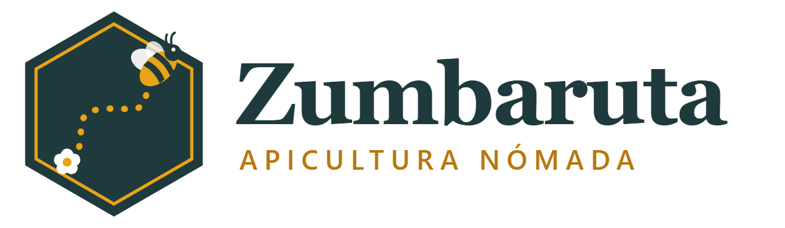

# SGE UD7: Odoo para Zumbaruta Apicultura Nómada

Puesta en marcha de Odoo como responsable de sistemas: instalación, plantilla con mínimo privilegio y una venta completa, del presupuesto a la factura.

| | |
|---|---|
| **Alumno** | Daniel Radulescu |
| **Empresa** | Zumbaruta Apicultura Nómada S.L. (ficticia) |
| **Sector** | Apicultura trashumante y polinización agrícola |
| **Lema** | «Miel que viaja con las flores» |
| **Odoo** | 19.0 Community con Docker Compose |
| **Vídeo** | Pendiente de publicar |

## Índice

| | Bloque | Documentos | Resultado |
|:-:|---|---|---|
| ✅ | **Instalación** | [Diapositiva](instalacion/instalacion-odoo.pdf) · [Errores](instalacion/errores-instalacion.md) | Odoo 19 Community en Docker; 5 errores documentados |
| ⏳ | **Empresa** | Pendiente | |
| ⏳ | **Usuarios** | Pendiente | |
| ⏳ | **Venta** | Pendiente | |
| ⏳ | **Vídeo** | Pendiente | |

Las [capturas](capturas/) sirven de apoyo a los bloques de usuarios y venta.

## Seguridad

El repositorio no contiene contraseñas. Solo aparece el correo de acceso de cada usuario.
