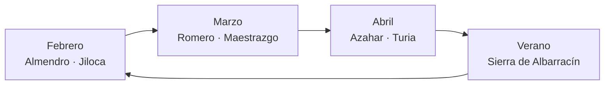
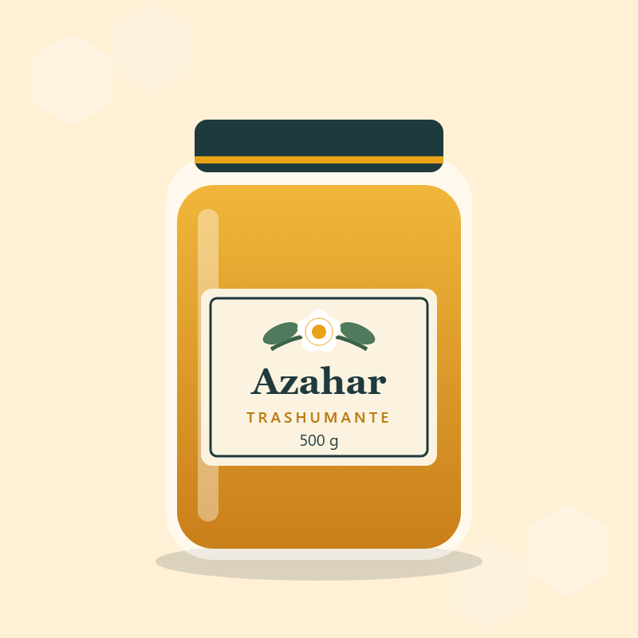

# Ficha de empresa: Zumbaruta Apicultura Nómada S.L.

> **Empresa inventada.** El nombre, el NIF, el teléfono y las direcciones son ficticios. Los correos y las webs usan el dominio `.example`, reservado para ejemplos, así que no pueden pertenecer a nadie.

## Actividad

Zumbaruta es una empresa de **apicultura trashumante**: sus colmenas viajan en camión siguiendo la floración de la península. *Zumbar* + *ruta*: su lema es **«Miel que viaja con las flores»**.

Tiene dos líneas de negocio que se alimentan entre sí:

1. **Polinización de cultivos.** Alquila colmenas a fincas de almendro durante la floración, cuando más falta hacen las abejas.
2. **Producto de cada parada.** Vende la miel y la cera que producen esas mismas colmenas, y organiza catas en ruta.

## Datos de la compañía en Odoo

| Campo | Valor |
|---|---|
| Razón social | Zumbaruta Apicultura Nómada S.L. |
| Sector | Agricultura y ganadería · apicultura y polinización |
| NIF ficticio | ESB00000000 |
| Dirección | Camino de la Trashumancia 14, 44100 Albarracín (Teruel), España |
| Teléfono | +34 978 000 147 |
| Correo | hola@zumbaruta.example |
| Web | https://www.zumbaruta.example |
| Moneda y plan contable | Euro · plan contable español (`l10n_es`, PYMES) |
| Almacén | Nave de Albarracín (código `ALB`) |
| Equipo de ventas | Equipo de ruta |

## Identidad y documentos

| Elemento | Valor | Uso |
|---|---|---|
| Verde noche | `#1F3A3D` | Color principal: títulos y logotipo |
| Ámbar miel | `#E8A317` | Acento del logotipo y del material gráfico |
| Ámbar oscuro | `#B9770E` | Color secundario de los documentos; se lee mejor sobre blanco |
| Crema | `#FBF3E0` | Fondos del material gráfico |
| Plantilla de documento | Folder | Presupuestos y facturas |
| Tipografía de documento | Lato | Presupuestos y facturas |
| Pie de documento | Razón social, NIF, teléfono, dirección, correo y web | Todos los PDF |
| Condiciones | Lote y consumo preferente; polinización con traslado, colocación y retirada | Presupuestos y facturas |

El logotipo está en [`logo.svg`](logo.svg) y [`logo.png`](logo.png). Representa una abeja que sigue una ruta punteada desde una flor, dentro de una celda de panal.

## Catálogo

Odoo tiene 6 productos propios. Las ilustraciones están en [`productos/`](productos/).

| Imagen | Código | Producto | Tipo | Precio | Coste | IVA | Stock inicial | Se factura según |
|---|---|---|---|---:|---:|---|---:|---|
|  | `ZR-MR500` | Miel de romero trashumante 500 g | Almacenable | 9,50 € | 4,20 € | 10 % | 240 | Cantidad entregada |
|  | `ZR-MA500` | Miel de azahar «Ruta del Turia» 500 g | Almacenable | 10,90 € | 4,85 € | 10 % | 180 | Cantidad entregada |
|  | `ZR-VC004` | Velas de cera de abeja (pack de 4) | Almacenable | 14,00 € | 5,60 € | 21 % | 90 | Cantidad entregada |
|  | `ZR-CR006` | Caja regalo «Seis paradas» (6 × 250 g) | Almacenable | 42,00 € | 21,50 € | 10 % | 40 | Cantidad entregada |
|  | `ZR-PA001` | Polinización de almendro (por colmena) | Servicio | 42,00 € | 23,00 € | 21 % | No aplica | Cantidad pedida |
|  | `ZR-TC001` | Taller-cata «Sabe a ruta» (por persona) | Servicio | 25,00 € | 9,00 € | 21 % | No aplica | Cantidad pedida |

Los tipos de IVA son una decisión de este ejercicio: los alimentos van al 10 % y el resto al 21 %.

## Clientes

| Cliente | Tipo | Población | Identificación ficticia | Comercial asignado |
|---|---|---|---|---|
| Almendra Tardía S. Coop. | Empresa | Calamocha (Teruel) | ESF00000000 | Lucía Ferrer |
| Marina Quiroga Lasheras | Particular | Zaragoza | 00000000T | Lucía Ferrer |
| Cerezas Valle Alto S.L. | Empresa | Caspe | Sin NIF | Sin asignar; alta de Noa Ibarra en la prueba de permisos |

El contacto de compras de Almendra Tardía, Rocío Benedí, tiene acceso de portal.
