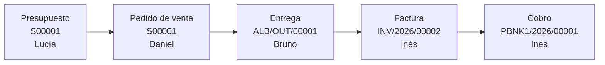

# Proceso de venta: del presupuesto a la factura

Venta de la **campaña de almendro 2027** a **Almendra Tardía S. Coop.** Cada paso lo hace el usuario que corresponde a su rol, nunca el administrador.

**Documentos impresos desde Odoo:** [`presupuesto.pdf`](presupuesto.pdf) y [`factura.pdf`](factura.pdf).

## Paso a paso

| # | Usuario | Rol | Qué hace | Documento | Estado |
|:-:|---|---|---|---|---|
| 1 | Lucía Ferrer | Comercial | Crea el presupuesto con 4 líneas, una con descuento del 10 %, pago a 30 días y validez hasta el 02/12/2026. Lo imprime en PDF. | `S00001` | Presupuesto |
| 2 | Daniel Radulescu | Responsable de ventas | Confirma el presupuesto. | `S00001` | Pedido de venta |
| 3 | Bruno Talavera | Almacén | Valida la entrega con cantidad hecha = cantidad pedida. | `ALB/OUT/00001` | Hecho |
| 4 | Inés Aldecoa | Administración | Crea la factura desde el pedido, la revisa y la publica. | `INV/2026/00002` | Registrado |
| 5 | Inés Aldecoa | Administración | Registra el cobro de 2.736,36 € en el diario Banco e imprime la factura. | `PBNK1/2026/00001` e `INV/2026/00002` | Pagado |
| 6 | Daniel Radulescu | Responsable de ventas | Comprueba el estado final. | `S00001` | Facturado y entregado |

## Detalle del pedido

| Código | Producto | Cantidad | Precio | Dto. | IVA | Importe |
|---|---|---:|---:|---:|---:|---:|
| `ZR-PA001` | Polinización de almendro (por colmena) | 40 | 42,00 € | 10 % | 21 % | 1.512,00 € |
| `ZR-CR006` | Caja regalo «Seis paradas» (6 × 250 g) | 12 | 42,00 € | | 10 % | 504,00 € |
| `ZR-MR500` | Miel de romero trashumante 500 g | 24 | 9,50 € | | 10 % | 228,00 € |
| `ZR-VC004` | Velas de cera de abeja (pack de 4) | 6 | 14,00 € | | 21 % | 84,00 € |

| Concepto | Importe |
|---|---:|
| Base imponible | 2.328,00 € |
| IVA 10 % sobre 732,00 € | 73,20 € |
| IVA 21 % sobre 1.596,00 € | 335,16 € |
| **Total** | **2.736,36 €** |

## El stock baja al validar la entrega

La polinización es un servicio y no mueve stock.

| Producto | Antes | Entregado | Después |
|---|---:|---:|---:|
| `ZR-CR006` Caja regalo | 40 | 12 | 28 |
| `ZR-MR500` Miel de romero | 240 | 24 | 216 |
| `ZR-VC004` Velas | 90 | 6 | 84 |

## Estado final del pedido

| Línea | Pedido | Entregado | Facturado |
|---|---:|---:|---:|
| `ZR-PA001` | 40 | 0 | 40 |
| `ZR-CR006` | 12 | 12 | 12 |
| `ZR-MR500` | 24 | 24 | 24 |
| `ZR-VC004` | 6 | 6 | 6 |

El servicio de polinización se factura por cantidad pedida y se presta en la floración de 2027, por eso figura como no entregado.

Capturas: [pedido S00001 facturado](../capturas/12-pedido-s00001-facturado.jpg) y [factura con la banda de pagado](../capturas/11-factura-pagada.jpg).

## Incidencia: factura parcial

La primera factura del pedido se canceló, y por eso la definitiva es la `00002`.

1. Al validar la entrega, Odoo abrió el asistente de confirmación por SMS y la entrega quedó sin validar.
2. Los productos almacenables se facturan por cantidad entregada. Al facturar, `INV/2026/00001` solo incluyó el servicio: 1.829,52 € en lugar de 2.736,36 €.
3. Se detectó al comparar el total de la factura con el del pedido.
4. Administración canceló el cobro y la factura, sin borrarlos, para conservar el historial.
5. Se desactivó el SMS, Almacén validó la entrega y Administración emitió la factura completa, `INV/2026/00002`.

| Documento | Importe | Estado |
|---|---:|---|
| `INV/2026/00001` | 1.829,52 € | Cancelada |
| Cobro cancelado `PBNK1/2026/00001` | 1.829,52 € | Cancelado |
| `INV/2026/00002` | 2.736,36 € | **Pagada** |
| Cobro válido `PBNK1/2026/00001` | 2.736,36 € | **Pagado** |

Por eso el pedido muestra *Facturas: 2*. Odoo volvió a usar el número del cobro cancelado para el cobro válido. El detalle técnico está en [`errores-instalacion.md`](../instalacion/errores-instalacion.md).

## Segunda venta: particular y desde la interfaz web

Para comprobar los mismos pasos en pantalla, se hizo otra venta completa a **Marina Quiroga Lasheras**, el cliente particular.

| Usuario | Qué hace | Documento | Estado |
|---|---|---|---|
| Daniel Radulescu | Crea y confirma el pedido: 2 cajas regalo y 3 mieles de azahar | `S00002` | Pedido de venta |
| Bruno Talavera | Valida la entrega | `ALB/OUT/00002` | Hecho |
| Inés Aldecoa | Entra por *Pedidos por facturar*, crea y publica la factura | `INV/2026/00003` | Registrado |
| Inés Aldecoa | Registra el cobro de 128,37 € | `PBNK1/2026/00002` | Pagado |

Capturas: [entrega](../capturas/08-almacen-entrega-lista-para-validar.jpg), [menú de Administración](../capturas/09-facturacion-menu-pedidos-por-facturar.jpg) y [asistente de factura](../capturas/10-facturacion-asistente-crear-factura.jpg).

## Cómo se ejecutó

- **`S00001`:** con las credenciales y la sesión de cada usuario, mediante la API XML-RPC de Odoo. Los PDF se imprimieron con la sesión de Lucía (presupuesto) y de Inés (factura).
- **`S00002`:** la creación del pedido se hizo por la API con la sesión de Daniel. La confirmación, la entrega, la factura y el cobro se hicieron en la interfaz web.

En ambos casos Odoo aplicó los permisos de cada usuario y registró quién hizo cada paso.
